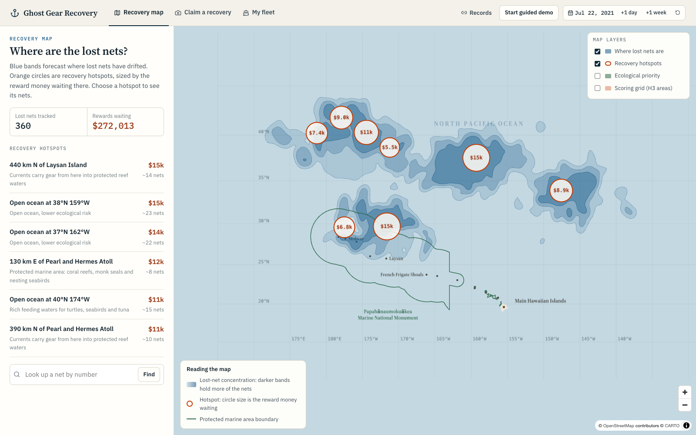
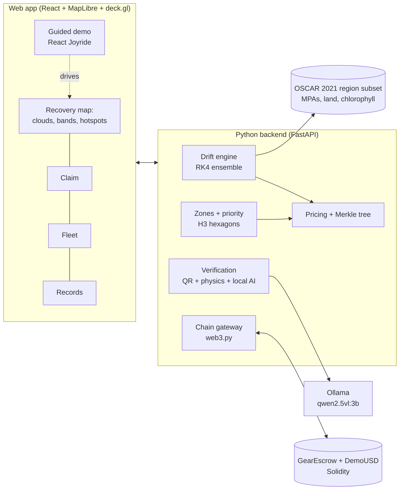
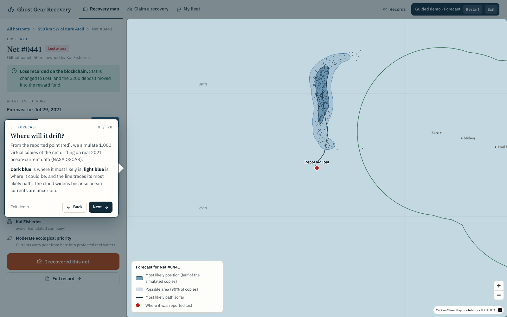
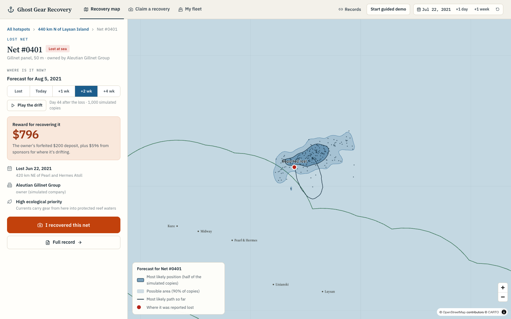
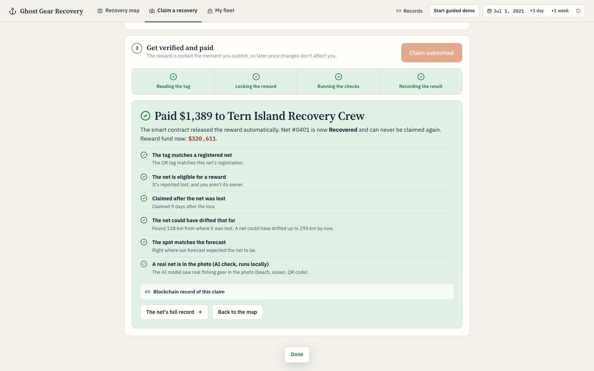
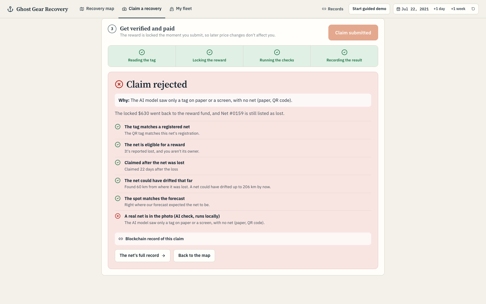
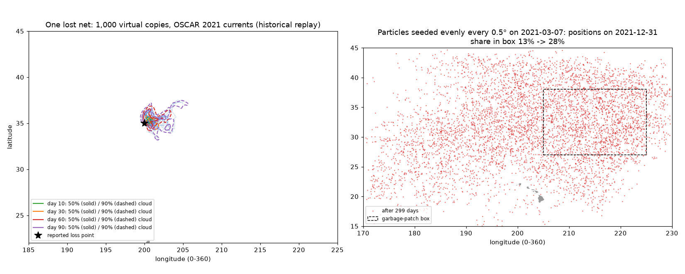

# Ghost Gear Recovery

**IEEE ClimateChain Global Hackathon 2026 · Track: Sustainable Supply Chains** (digital product passports, circular-economy incentives)

<!-- LINKS -->
**Live demo:** coming shortly · **Demo video:** coming shortly · **Public testnet deployment:** coming shortly
<!-- /LINKS -->

Lost fishing nets ("ghost gear") keep catching and killing marine life for years. They stay lost for three practical reasons: nobody knows whose net it is, nobody knows where it has drifted, and nobody is paid to bring it back. This prototype gives every net all three:

| | How | Where it lives |
|---|---|---|
| **An owner** | Each net gets an ERC-721 passport and a printed QR tag at purchase, with a refundable deposit held by a smart contract | On-chain |
| **A location** | When a net is reported lost, 1,000 possible paths for that one net drift on real ocean currents, producing a probability cloud | Off-chain model, real data |
| **A price** | Zone-based rewards: the owner's forfeited deposit plus a sponsor-funded top-up weighted by environmental priority. Each day's price list is sealed on-chain as a Merkle root | Off-chain pricing, on-chain commitment |

When a recovery crew submits a photo, the QR tag identifies the net, the advertised reward **locks on-chain** (the claim carries a Merkle proof of its price), automated checks run (physics plus a free local AI model), and the contract **pays out automatically** or returns the money to the pool.



---

## What is real and what is simulated

| | What | Status |
|---|---|---|
| ON-CHAIN | Solidity contracts: passports, deposits, reward pool, daily price-list Merkle roots, claims with proofs, payouts | **Real** transactions (a local chain for the guided demo; the same contract on the public Base Sepolia testnet) |
| HISTORICAL DATA | NASA/ESR **OSCAR v2.0** surface currents, 7 Mar–31 Dec 2021 (replayed as if live); NOAA sanctuary boundaries; Natural Earth coastlines; NOAA ERDDAP chlorophyll | **Real** public data |
| MODEL | Drift forecasts, probability clouds, zone priorities, rewards | **Real** computations |
| LOCAL AI | `qwen2.5vl:3b` via Ollama, checking that the photo shows physical gear, not just a tag | **Real** model, free and offline |
| SIMULATED | Fishing companies, nets, 360 past loss events, sponsors, recovery crews, evidence photos (public-domain net photos with a digital tag) | Labeled in the app. Money is play money (dUSD) |

---

## Architecture



**Flow:** checkout → `registerNets` (passports + deposits) → `reportLoss` (deposit moves to the reward pool, forecast starts) → daily `publishEpoch(merkleRoot, total)` (the contract refuses lists that promise more than the pool holds) → `submitClaim(proof)` (price locked) → verification → `resolveClaim(outcome, reportHash)` → payout or refund to the pool.

**On-chain:** ownership, statuses, money buckets, price-list roots, claims and report fingerprints. **Off-chain, fingerprinted on-chain:** exact loss coordinates (private fishing grounds), forecasts, photos and full reports.

**Why a blockchain:** a fishing fleet, a sponsor and a recovery crew in different countries share no common authority. The contract holds every dollar, enforces the rules (no double payment, no owner self-claims, no over-promising, deposits kept apart from rewards) and pays out, and all three parties can audit the same record.

---

## Run it locally

Requirements: macOS or Linux, Python 3.13, Node 18+, [Foundry](https://getfoundry.sh) and [Ollama](https://ollama.com). The ocean-current data the app needs ships in `data/derived/` (62 MB: the whole demo region, every day of the 300-day 2021 record). The 10 GB OSCAR source file is only needed to rebuild it.

```bash
scripts/setup.sh     # Python venv, contracts (+ tests), web build, local vision model (~3 GB, one time)
scripts/run.sh       # local chain + Ollama + app  ->  http://127.0.0.1:8000
```

The first start deploys the contracts and seeds the simulated world (about 2 minutes, mostly 360 drift forecasts). Without Ollama the app still runs; the photo check then falls back to "flag for review".

### Guided demo (start here)

The home page offers **Start guided demo** and **Explore independently**. The guided demo walks a first-time viewer through one net's life in 28 short steps (about 4 minutes), driving the real app with real clicks:

1. **Problem → solution** (identify, predict, pay).
2. **Register gear**: a supplier checkout registers six nets; Net #0441's passport and QR tag appear.
3. **Report a loss**: status and deposit change in one blockchain transaction.
4. **Forecast**: the drift cloud animates on the 2021 OSCAR currents; the clock moves forward 21 days, recalculating rewards and sealing each day's reward list on-chain.
5. **Marketplace**: 360 other losses combined into concentration bands and reward hotspots; ecological priority as a separate layer.
6. **Claim**: staged tag photo → QR identification → location → submit.
7. **Payout**: the checks, the automatic payment and the transactions.
8. **Fraud check**: a photo of a printed tag is rejected by the local AI check and the locked reward returns to the pool.

Starting the demo restores the seeded world, so every run produces the same net (#0441).



### Exploring independently

- **Recovery map** (`#/explore`): bands show where lost nets are concentrated; circles are reward hotspots. Choose a hotspot, then a net to see its forecast and reward.
- **Claim a recovery** (`#/claim`): choose staged evidence (or upload a photo), mark where it was found, submit. Fraud tests: the printed-tag photo, an impossible location, claiming the same net twice.
- **My fleet** (`#/fleet`): register nets, report one lost, or retire one to get its deposit back.
- **Records** (`#/records`): the money held by the contract and every transaction in plain English.





---

## Validation (all reproducible)

| Check | Command | Result |
|---|---|---|
| Contracts: unit tests + Python↔Solidity Merkle fixture + invariant fuzzing (books always balance; reserved = open claims) | `cd contracts && forge test` | 16/16 pass |
| Drift time-step convergence (3 h vs 1 h steps, 30 days) | `python -m engine.validate_drift` | median difference 0.00 km, p95 0.01 km |
| Drift reproduces known physics: uniform seeding accumulates in the garbage-patch region | same | share in box 27–38°N 135–155°W: 13% → 28% over 2021 |
| Zone priority varies meaningfully | `python -m engine.zones` | 1,578 zones, priority 1.00–5.38 |
| Full loop on a live chain, including fraud cases | `python -m engine.e2e` | accept/pay, reject ×2, contract refusal, books balance |
| Local AI scene check | (in e2e) | 6/6 test photos correct; ~4–5 s per photo on an M1 Pro |



---

## Public testnet

The same contracts can be deployed to Base Sepolia and run through one full lifecycle, so anyone can inspect the transactions on a block explorer:

```bash
.venv/bin/python -m engine.testnet new-wallet   # creates a testnet-only wallet in .env, prints the address to fund
# request free Base Sepolia test ETH for that address from a faucet, then:
.venv/bin/python -m engine.testnet run          # deploy + one full lifecycle; explorer links -> runtime/testnet.json
```

---

## Repository layout

```
contracts/   Solidity (GearEscrow, DemoUSD), Foundry tests incl. invariants
engine/      Python: extract, drift, zones, forecast, pricing, merkle, tags, vision, verify, chain, world, api, e2e, testnet
web/         React + MapLibre + deck.gl app
data/derived OSCAR 2021 region subset and zone priorities (inputs the app needs)
scripts/     setup.sh, run.sh
media/       screenshots for this README
```

## Honest limits
- Currents are 2021 history at 0.25°. There is no direct wind push, sinking or net-type physics.
- A photo cannot prove a net came out of the sea. The checks raise the cost of cheating; they don't make it impossible.
- In this prototype one service key prices and verifies. Every list and report is fingerprinted on-chain for audit; the roadmap is multiple independent verifiers.

## Data and credits
OSCAR v2.0 (NASA/ESR, via PO.DAAC) · NOAA Office of National Marine Sanctuaries boundary files · Natural Earth (public domain) · NOAA CoastWatch ERDDAP `erdMH1chlamday` · Evidence base photos: public domain, see [`engine/assets/evidence/CREDITS.md`](engine/assets/evidence/CREDITS.md) · Basemap © OpenStreetMap contributors © CARTO.

Problem statistics: Richardson et al., *Science Advances* (2022), about 2% of fishing gear lost per year; Lebreton et al., *Scientific Reports* (2018), at least 46% of the Great Pacific Garbage Patch's floating plastic mass is fishing nets.

## License
MIT
